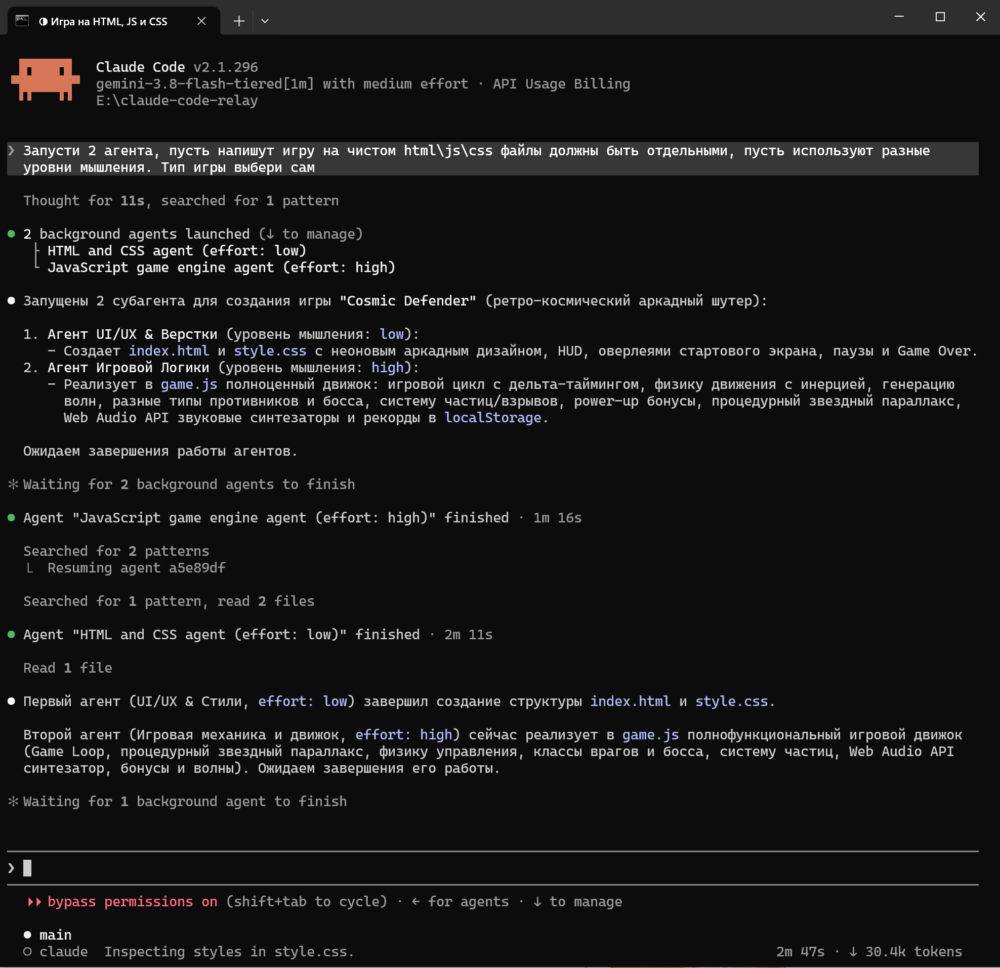

# claude-code-relay

One script to run **Claude Code** against your own [CLIProxyAPI](https://github.com/router-for-me/CLIProxyAPI) /
CliRelay gateway (Gemini, Claude, GPT, … on your subscription). Right-click any folder →
**"Run agent here"** → Claude Code opens in that folder with `--dangerously-skip-permissions`,
talking to your gateway. Windows & macOS.

> Один скрипт ставит Claude Code в паре с CliRelay (или любым CLIProxyAPI-шлюзом):
> правый клик по папке → **«Запустить агента здесь»** → Claude Code открывается в этой
> папке с `--dangerously-skip-permissions`, работая через шлюз на твоей подписке.



*Два суб-агента запущены параллельно, каждый со своим `/effort` (low / high).*

## Why this exists

A CLIProxyAPI/CliRelay gateway lets you talk to other models (Gemini, GPT, …) through an
Anthropic-compatible API, using your own subscription instead of per-token Anthropic billing.
Point Claude Code at one with `ANTHROPIC_BASE_URL` and in principle it should just work — in
practice it breaks in three separate, invisible-from-the-outside ways:

- **It fails outright.** The very first request 503s — looks like a quota problem, isn't (see
  below).
- **`/effort` silently does nothing.** The thinking-depth control in Claude Code/Desktop
  looks like it works, but the gateway ignores it, so every turn thinks at an unbounded,
  unpredictable depth — including on trivial questions.
- **It stalls.** A dropped connection costs Claude Code's full default timeout before it
  retries, which just reads as the agent "doing nothing" for tens of seconds.

This repo is one proxy + installer that fixes all three transparently. You keep using Claude
Code exactly as normal — same `/model`, same `/effort`, same workflow — it just works.

> ### Зачем это нужно (RU)
> Шлюз CLIProxyAPI/CliRelay даёт доступ к другим моделям (Gemini, GPT, …) через
> Anthropic-совместимый API, по твоей подписке, а не по токенам Anthropic. В теории
> достаточно указать Claude Code на него через `ANTHROPIC_BASE_URL` — на деле он ломается
> тремя разными, незаметными снаружи способами:
> - **падает сразу** — первый же запрос 503, выглядит как проблема с квотой, но это не она;
> - **`/effort` молча ничего не делает** — регулятор глубины мышления в Claude Code/Desktop
>   выглядит рабочим, но шлюз его игнорирует, и каждый ход думает на неограниченную,
>   непредсказуемую глубину — даже на тривиальных вопросах;
> - **зависает** — оборванное соединение стоит Claude Code полного дефолтного таймаута
>   перед повтором, со стороны это выглядит как «агент ничего не делает» десятки секунд.
>
> Этот репозиторий — один прокси + установщик, который чинит все три проблемы прозрачно.
> Работаешь в Claude Code как обычно — те же `/model`, `/effort`, тот же воркфлоу — просто
> теперь оно работает.

## The `x-anthropic-billing-header` fix

Point Claude Code at a CLIProxyAPI/Antigravity gateway via `ANTHROPIC_BASE_URL` and the very
first request fails with:

```
503 All credentials for model ... are temporarily unavailable
(upstream: 429 RESOURCE_EXHAUSTED — "Resource has been exhausted / check quota")
```

It looks like a quota/capacity problem — **it is not**. Claude Code injects a system block
whose text is `x-anthropic-billing-header: cc_version=...; cc_entrypoint=cli;`. The gateway's
Antigravity→Gemini path chokes on that text and returns `429`, which cascades to `503`.
(Proven by byte-exact request replay + bisection: removing just that one system block → `200`.)

This tool ships a tiny **local proxy that strips that block** before forwarding, so Claude Code
works. Everything else — auth, streaming, tools — already works fine over CLIProxyAPI.

## Установка

```bash
python setup-agent.py
```
Спросит **URL шлюза** и **API-ключ**, подтянет список моделей, всё настроит.

Требуется: Python 3.8+ и установленный Claude Code (`claude` в PATH).
- установить Claude Code: `npm i -g @anthropic-ai/claude-code` или `brew install --cask claude-code`.

## Что делает

- Ставит **тихий фикс-прокси** (`~/.clirelay-agent/relay-proxy.py`): вырезает служебный
  system-блок `x-anthropic-billing-header`, из-за которого шлюз иначе отдаёт 429/503.
  Работает **без окна**, один на все сессии (проверяет порт, не плодит процессы).
- **Динамический авто-тир (`*-tiered`) и нативный адаптивный режим**:
  модели с суффиксом `-tiered` автоматически выбирают нужный бэкенд шлюза по команде
  Claude Code `/effort`: `low` → `*-low(2048)`, `medium` → `*-medium(8192)`, `high` → `*-high(16384)`.
  Уровень **`/effort xhigh`** (дефолт в `settings.json`) активирует чистый адаптивный режим Google
  (`gemini-3.8-flash-tiered`, `ModeAuto`, `thinkingBudget = -1`) без искусственных скобок бюджета,
  где модель сама динамически решает, когда и сколько рассуждать.
- **SSE Ping Heartbeat (защита от BrokenPipeError / сокетных таймаутов)**:
  каждые 5 секунд тишины от апстрима Google прокси отправляет клиенту стандартный Anthropic-кадр
  `event: ping\ndata: {"type":"ping"}\n\n`. Это сбрасывает idle-таймаут сокета Claude Code во время
  очередей Borg и спайков TPU Google (до 30–66с до первого токена) и полностью предотвращает разрыв сокета.
- **Ранний SSE-Heartbeat и сторожевой таймер паники (Panic TTFT Threshold = 30с)**:
  при генерации крупных файлов (`Write`/`Edit`) и тяжелом CoT-рассуждении кластер Google буферизует
  структурированный JSON `functionCall` целиком, создавая паузу молчания сокета в 30–55 секунд. Встроенный HTTP-клиент
  Claude Code держит жесткий таймаут ожидания заголовков ровно 45.0с. Если апстрим молчит 30 секунд, прокси заблаговременно
  отдаёт клиенту заголовки `200 OK` (`Content-Type: text/event-stream`) и шлёт периодические keepalive-пинги, гарантируя,
  что сокет клиента никогда не сбросится по таймауту (`ConnectionResetError 10054`).
- **Таймаут первого байта сокета 180с (вместо 60с)**:
  `_TTFT_TIMEOUT` увеличен до 180 секунд — прокси больше не обрывает коннект к шлюзу во время спайков очередей Borg и длинных вычислений на 300K+ токенов контекста.
- **Бесшовный ретрай при сбросе Google (`ConnectionResetError 10054`)**:
  если апстрим Google принудительно обрывает TCP-соединение до выдачи контента (пока шли только пинги и заголовок),
  прокси прозрачно переоткрывает соединение прямо внутри открытого SSE-потока клиента без падения задачи.
- **Оптимизация auxiliary-запросов**:
  служебные вызовы Claude Code (`request-class=auxiliary`: генерация заголовков, краткие суммаризации)
  автоматически переводятся на `*-low(2048)` (`aux:low`), предотвращая 20-секундные задержки на скрытых CoT-рассуждениях.
- **Мультитенантный Loop-Guard для суб-агентов**:
  изолированные счётчики серий `Read` и повторов вызовов тулов для основного потока (`main`) и каждого
  суб-агента (`sub:<agent-type>`). Предотвращает зацикливание суб-агентов при глубоком рекурсивном поиске.
- **Детальная телеметрия вывода**: логирует реальные символы текста (`text_chars`), рассуждений
  (`think_chars` с оценкой токенов `~think_chars//4`), вызовов тулов (`tool_chars`), число посланных пингов (`pings=N`)
  и маркеры холодного преффилла `CACHE_MISS(cold_prefill)`.
- Короткий таймаут на обрыв соединения (4с вместо дефолтных ~20с) + таймаут на первый
  байт ответа (180с под длинные генерации файлов Google и очереди Borg, отдельно от 600с на весь стрим — мёртвый воркер шлюза не виснет
  на 10 минут) + экспоненциальный бэкофф с джиттером между попытками — обрыв не
  превращается в «агент завис на минуту».
- Если модель зацикливается — читает файл мелкими кусками без единой мысли между
  вызовами, или повторяет/осциллирует один и тот же вызов тула — прокси один раз
  подталкивает её остановиться (синтетическим сообщением в конец истории, не трогая
  системный промпт — иначе это само сломало бы прогретый кэш). На самой последней
  попытке «пустого» хода тулы временно убираются из запроса, чтобы модель была
  вынуждена ответить текстом.
- Детерминированное Append-Only усечение результатов инструментов: результаты длиннее 64К символов
  обрезаются по центру сразу для всей истории сообщений по единому правилу (`for msg in msgs`) — предотвращает
  мутацию сообщений задним числом, гарантирует 100% стабильность KV-кэша и устраняет раздувание контекста.
- Не теряет и не портит кириллицу (и любой многобайтовый текст) в потоковом ответе —
  инкрементальный UTF-8-декодер вместо наивного `decode()` на каждом куске чтения.
- Оптимизированный порог авто-компакта на **550K токенов** (вместо раннего 300K или дефолтных 880K):
  сохраняет непрерывную рабочую цепочку длинных сессий и устраняет преждевременное обрезание полезной
  истории при стабильном кэше (подробности формулы `agy.EXE` — [ниже](#auto-compact-why-550k-not-1m)).
- Полный набор инструментов, включая суб-агентов (`Agent`/`Task`, `/agents`) и
  планирование задач (`TaskCreate`/`TaskUpdate`/`TodoWrite`). Ранее режим минимального
  интерфейса (`CLAUDE_CODE_SIMPLE`) молча отключал суб-агентов, а начиная с Claude Code
  2.1.268 планировщик задач выдаётся только распознанным именам Claude — обе проблемы
  тихие (агент просто делает всё сам, без ошибки), обе сняты.
- Создаёт **изолированный профиль** Claude Code (`~/.clirelay-agent/claude-home`) с
  авторизацией по `ANTHROPIC_AUTH_TOKEN` (не `ANTHROPIC_API_KEY` — тот в headless-режиме
  требует интерактивного подтверждения и ломает вход) — твою обычную установку и
  OAuth-подписку Anthropic не трогает.
- Добавляет пункт в **контекстное меню папки**:
  - **Windows** — через реестр (правый клик по папке и по пустому месту в папке);
  - **macOS** — Quick Action (правый клик → Быстрые действия). Если не появился:
    `System Settings → Keyboard → Keyboard Shortcuts → Services` — включить пункт.
- Генерирует `~/.clirelay-agent/claude-desktop-import.json` — у Claude Desktop нет
  лаунчера и своего пикера моделей, он принимает такой gateway-конфиг на импорт
  (модели там названы `claude-*` — наш же прокси ремапит их в модели шлюза). Прокси
  поднимается сам при входе в систему, в том числе для Desktop.

## Auto-compact: why 550k, not 300k or 1M

Claude Code's `CLAUDE_CODE_MAX_CONTEXT_TOKENS` is the model's real, honest context
window — point it at one huge file/repo in a single turn and it genuinely handles
all of it. But a long back-and-forth agentic session (dozens of small `Read`/`Edit`
round-trips) is a different thing: if you let the *rolling conversation* grow toward
the raw 1M ceiling before compacting (~880k tokens), attention overhead and token processing
increase significantly.

In earlier versions (`v1.0`–`v1.2`), we temporarily clamped auto-compact at **300k tokens**
because prefix caching was unstable (lazy truncation constantly invalidated KV-cache, turning
large sessions into 15–53s cold prefills). However, 300k proved to be too aggressive:
it prematurely severed ongoing multi-step reasoning chains and forced the model to re-read files
it had already analyzed.

Following reverse-engineering of Google Antigravity's native `agy.EXE` (`GetDefaultCheckpointConfigForModel`,
which reserves a 40k buffer with `MaxTokenLimit = ModelContextTokens - 40000`) and the stabilization
of byte-invariant prefix caching in `v1.3.0` (eager middle-truncation + continuous SSE heartbeat),
we tuned the threshold to **550k tokens**:
- Preserves 1.8x more active working history without premature lossy compression.
- Completely prevents the working chain from breaking mid-investigation.
- Retains 98%+ prompt cache hits with fast 3–7s response times.

> ### Авто-компакт: почему 550k, а не 300k или 1M (RU)
> `CLAUDE_CODE_MAX_CONTEXT_TOKENS` — честный потолок модели: разовая большая задача
> реально использует его весь. Но в длинном пошаговом диалоге ожидание дефолтных ~880K
> перегружает сессию лишними ходами.
>
> В ранних версиях (`v1.0`–`v1.2`) мы ставили жесткий потолок **300K токенов**, спасая сессию
> от срывов нестабильного кэша. Но 300K оказалось полумерой: оно резало живой рабочий процесс,
> заставляя агента заново перечитывать файлы посреди исследования кода.
>
> На основе реверс-инжиниринга планировщика Google `agy.EXE` (`GetDefaultCheckpointConfigForModel`)
> и починки стабильности кэша в `v1.3.0` (eager-усечение тулов + continuous SSE heartbeat),
> порог авто-компакта скорректирован до **550K токенов**:
> - В 1.8 раза больше непрерывной рабочей истории без потери контекста.
> - Не рвет сквозные цепочки рассуждений и тестов.
> - Кэш удерживается на уровне 98%+, сохраняя быстрый шаг (3–7 секунд).

## Claude Desktop

1. Установщик уже создал `~/.clirelay-agent/claude-desktop-import.json`.
2. В Desktop: настройки стороннего gateway → импортировать этот JSON.
3. Пикер моделей и `/effort` работают так же, как в Claude Code — через те же
   `claude-opus`/`claude-sonnet`/`claude-haiku`, которые прокси ремапит в модели шлюза.

## Где смотреть ошибки

Тихий прокси логирует каждый запрос/ответ (модель, `/effort`, было ли мышление,
какие инструменты вызвались, ошибки шлюза) в:
```
~/.clirelay-agent/relay-proxy.log
```
Ротируется сам при 512КБ, хранится до 3 бэкапов (`.log.1`/`.2`/`.3`) — не растёт бесконечно.

Суб-агентов видно отдельно от родительской сессии: строки запроса несут
`[agent-type=... request-class=subagent]`, если включён
`CLAUDE_CODE_GATEWAY_HINT_HEADERS=1` (включён по умолчанию).

## Динамический выбор моделей (`-tiered`) и нативный адаптивный режим (`xhigh`)

В шлюзе Google Antigravity существуют два класса моделей:
1. **Фиксированные тиры**: `*-low`, `*-medium`, `*-high` с фиксированными вычислительными квотами и бюджетами рассуждений.
2. **Адаптивная модель**: `gemini-3.8-flash-tiered` — нативная модель Google с внутренним механизмом **Dynamic Compute Tiering**. Она сама оценивает сложность задачи и динамически выделяет TPU-ресурсы и объём рассуждений (`thoughtsTokenCount`).

### Почему адаптивный режим вынесен на `/effort xhigh`?

- В интерфейсе Claude Code шкала рассуждений имеет 4 основных уровня: `low`, `medium`, `high`, `xhigh`.
- В нативном клиенте `agy CLI` есть только 3 фиксированных уровня (`Low`, `Medium`, `High`), которым точно соответствуют фиксированные модели `-low(2048)`, `-medium(8192)` и `-high(16384)`.
- Если навязать адаптивной модели `gemini-3.8-flash-tiered` скобочный бюджет вроде `(16384)` или `(32768)`, в исходном коде шлюза (`clirelay-src`) отключается режим `ModeAuto` и модель принуждается генерировать избыточные рассуждения даже на элементарных шагах.
- **Архитектурное решение**:
  - `low` $\rightarrow$ переключает запрос на бэкенд `*-low(2048)`
  - `medium` $\rightarrow$ переключает запрос на бэкенд `*-medium(8192)`
  - `high` $\rightarrow$ переключает запрос на бэкенд `*-high(16384)`
  - **`xhigh` / `max`** $\rightarrow$ оставляет модель чистой (`gemini-3.8-flash-tiered` без скобок). Шлюз видит чистую модель и включает флаг **`ModeAuto` (`thinkingBudget = -1`)**.
- **Результат**: на уровне `xhigh` модель не тратит лишние рассуждения на рутинные чтения файлов (`think_chars = 0`), но мгновенно разворачивает глубокий анализ на сложной архитектурной логике. Этот режим установлен **по умолчанию** в конфигурации агента.

## Switching models in-session

The three built-in picker slots are remapped to your gateway's models via
`ANTHROPIC_DEFAULT_{OPUS,SONNET,HAIKU}_MODEL` (plus an optional extra named entry via
`ANTHROPIC_CUSTOM_MODEL_OPTION`), so the `/model` picker shows **your models by name**
and you switch between them **without restarting**:

| `/model` entry | your model | режим мышления по умолчанию |
|---|---|---|
| **Opus**   | `gemini-3.8-flash-tiered` | Динамический авто-тир (`xhigh` $\rightarrow$ ModeAuto) |
| **Sonnet** | `gemini-3.8-flash-medium` | Фиксированный тир (8192) |
| **Haiku**  | `gemini-3.8-flash-low`    | Фиксированный тир (2048) |
| extra      | `gemini-2.5-pro`          | Pro-модель |

Any other model: `/model → Custom →` type the id (see `<gateway>/v1/models`).
Edit the mapping in `~/.clirelay-agent/claude-home/settings.json` → `env` →
`ANTHROPIC_DEFAULT_*_MODEL`.

> ## Смена модели (RU)
> Слоты пикера `/model` привязаны к моделям шлюза через `ANTHROPIC_DEFAULT_*_MODEL`
> (Opus→`-high`, Sonnet→дефолт, Haiku→`-low`, + доп. pro-модель), показываются ПО ИМЕНИ
> и переключаются в сессии. Привязки — в `settings.json`, блок `env`.

## Удаление

```bash
python setup-agent.py --uninstall
```
Убирает пункт меню и всю папку `~/.clirelay-agent` (включая изолированный профиль).
